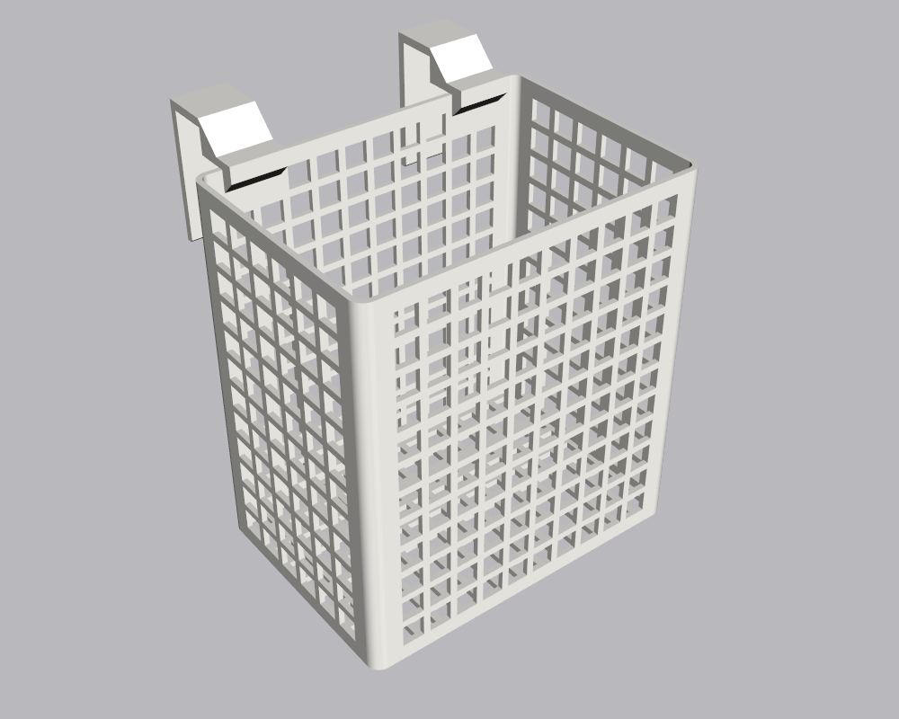
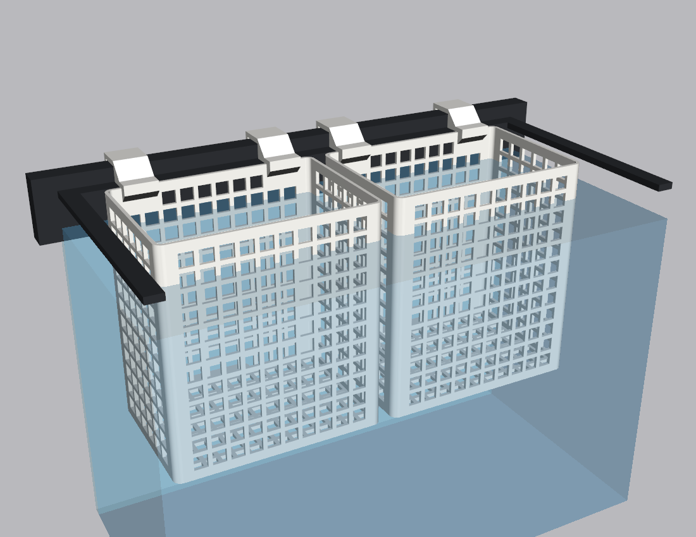
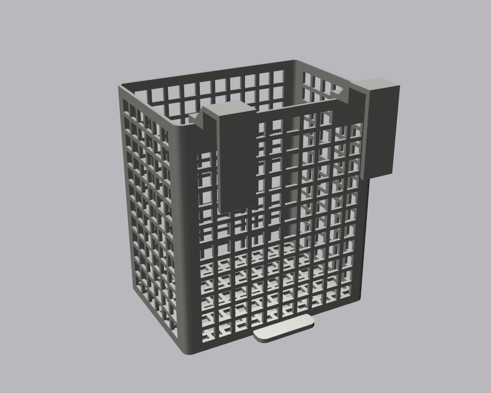
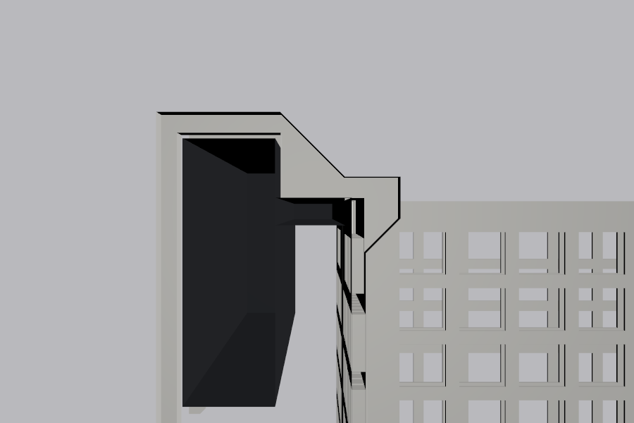
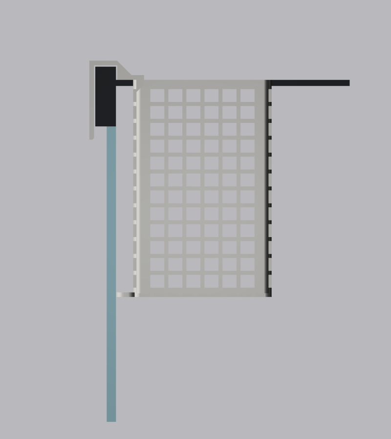

# Aquarium Basket

A grid-walled plant basket, like a dishwasher's cutlery basket, that hangs inside the tank against
its end wall. It's 5.5 in (140 mm) tall and 3.5 in (89 mm) out from the wall. Its width along the
wall is worked out so two of them fill the end wall side by side, with room to spare at the corners,
or you can set it yourself.

Two hooks are built into the top of each basket's back wall, so there's nothing to come loose.
Each sits on the frame's inner lip and wraps over the top of the frame, and the basket's rim ends up
level with the lip.

A short flat plate at the bottom of the back wall, in the middle, reaches out to the glass. The
hooks hold the top of the basket 11 mm in from the glass (the 10 mm lip plus a 1 mm gap), and
without the plate the basket's weight swings its bottom in towards the glass. The plate's edge presses
on the glass, so the basket hangs straight.

| Basket | Two on the end wall | Back, with the hooks |
|---|---|---|
|  |  |  |

| A hook cut through, on the frame | Hanging straight, with the plate on the glass |
|---|---|
|  |  |

## Printing

Designed for a Prusa MK4 printing PETG (not yet test-printed). PETG is fine in fresh water. Skip
any additives or colourants you wouldn't put in a tank.

| File | Print | Notes |
|---|---|---|
| [out/basket.stl](out/basket.stl) | 2 | 127.5 × 117 mm footprint with the hooks, 154 mm tall. Prints open top up. |

The hooks reach out over the frame, so they need supports. In PrusaSlicer, set **Supports** to
**For build plate only** and the **Style** to **Organic**. Keep **Don't support bridges** on (it
is by default). The only supports are then a small tree under each hook, standing on the bed
behind the basket. Snap them off after printing.

Everything else prints without supports:
- The wall openings are about 8 mm square, and their tops are short flat bridges.
- The floor has 6 mm openings, small enough to hold gravel or clay pebbles.
- The plate on the back lies on the build plate, level with the floor.
- Inside the back wall, a gusset under each hook stiffens the joint. Its underside slopes at 45°.
- Solid bands run around the rim, the bottom and either side of each corner for stiffness.

A STEP file for other CAD tools is in [out/aquarium_basket.step](out/aquarium_basket.step).

## Fit

The tank's end wall is 287 mm between the front and back lip edges. Two baskets of 127.5 mm leave
12 mm at each end and 8 mm between them, so they still fit if that measurement is a little long.
They have to stay inside the lip edges, because the rim is level with the lips and would hit the
front and back lips at the corners.

The hooks are sized for this tank's frame. The lip is 8.5 mm below the top edge and 10 mm wide,
and the frame top is 9/16 in (14.3 mm) across. A test print gripped better 1 mm narrower, so the
hooks are made for 13.3 mm. Each hook's leg down the outside of the tank is 2 in (50.8 mm) long
overall. The hooks fit the frame the same way as the [planter's](../aquarium-planter/) clip-on
hook, so printing that hook first is a quick way to check the fit before printing the baskets.

The first hooks had a 3 mm arm over the frame, and the slope up to it left them only 2 mm thick at the inside corner where the arm leaves
the pad on the lip. That's where they bend when the leg is pushed out, and two of them snapped
there. Now the arm is 5 mm thick, and the slope starts further back so the corner is 5 mm thick
too, which makes it about six times as strong in bending. The hook stands 2 mm taller above the
frame, and it sits on the lip and grips the frame exactly as before. The planter's hook had the
same thin corner and is made the same way now.

The glass is 11 mm out from the back wall: in line with the frame's inner wall, behind the lip.
The plate at the bottom reaches 2 mm past that, 13 mm in all, so it pushes the bottom of the basket
out from the glass a little and the basket can't lean in at the bottom. Set `STANDOFF_PRESS` to 0
for a plate that only just meets the glass, or raise it to push harder or if your glass is set
further back.

About 115 mm of each basket sits under water when the water is 25 mm below the lip.

## Customising

Every dimension is a parameter at the top of [aquarium_basket.py](aquarium_basket.py). The ones
you're most likely to change:

| Parameter | Default | What it does |
|---|---|---|
| `HEIGHT`, `DEPTH` | 139.7, 88.9 | Basket height and how far it reaches out from the wall. |
| `WIDTH` | 0 | Width along the wall. 0 works it out from `COUNT` to fill the end wall. Anything else sets it, at least 80 mm so the hooks fit. |
| `COUNT` | 2 | How many baskets share the wall, when `WIDTH` is 0. The width adjusts to fit. |
| `END_CLEAR`, `BETWEEN` | 12, 8 | Room at the corners and between baskets. |
| `GRID_OPENING`, `FLOOR_OPENING` | 8, 6 | Size of the square openings in the walls and floor. |
| `OPENING` | 287 | The end wall's length between the lip edges. |
| `FRAME_TOP_W`, `FRAME_CLEAR` | 13.3, 0.8 | Raise them if the hooks won't go over the frame. Lower them if the basket leans into the tank. |
| `HOOK_T` | 5 | Thickness of each hook's arm over the frame, and the least it is anywhere above the pad. |
| `LEG_L` | 50.8 | Overall length of each hook's leg down the outside of the tank (2 in). |
| `STANDOFF_T` | 3 | Thickness of the plate that rests on the glass. 0 leaves it off. |
| `STANDOFF_W` | 40 | Its length along the wall, centred. Set it longer than the basket (say 200) to run it the full length. |
| `STANDOFF_PRESS` | 2 | How far past the glass the plate reaches. Raise it to push the bottom out harder. |

Rebuild and re-render from the repo root:

```bash
.venv/Scripts/python aquarium-basket/aquarium_basket.py
```

```bash
.venv/Scripts/python aquarium-basket/render.py
```
