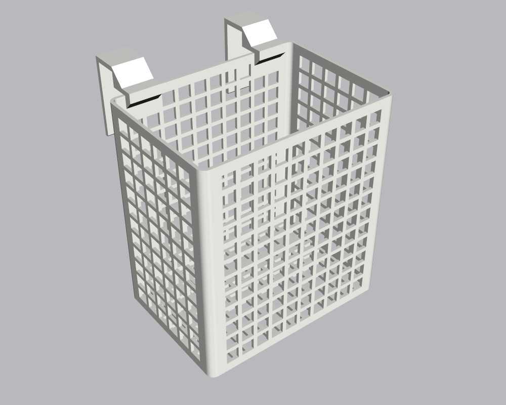
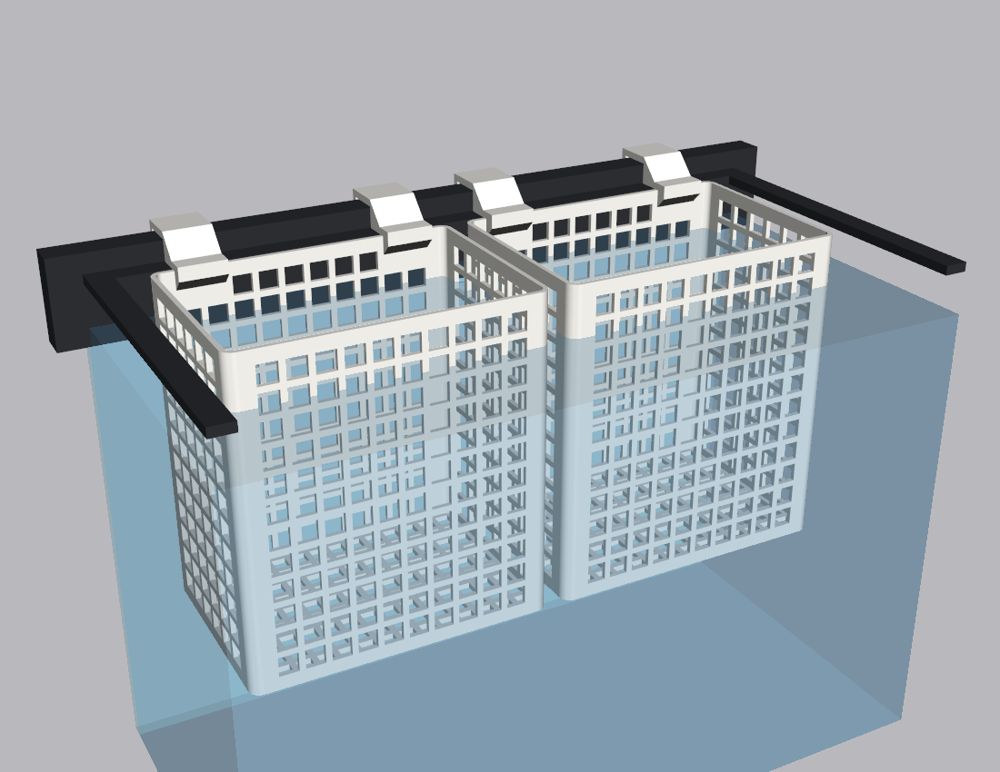
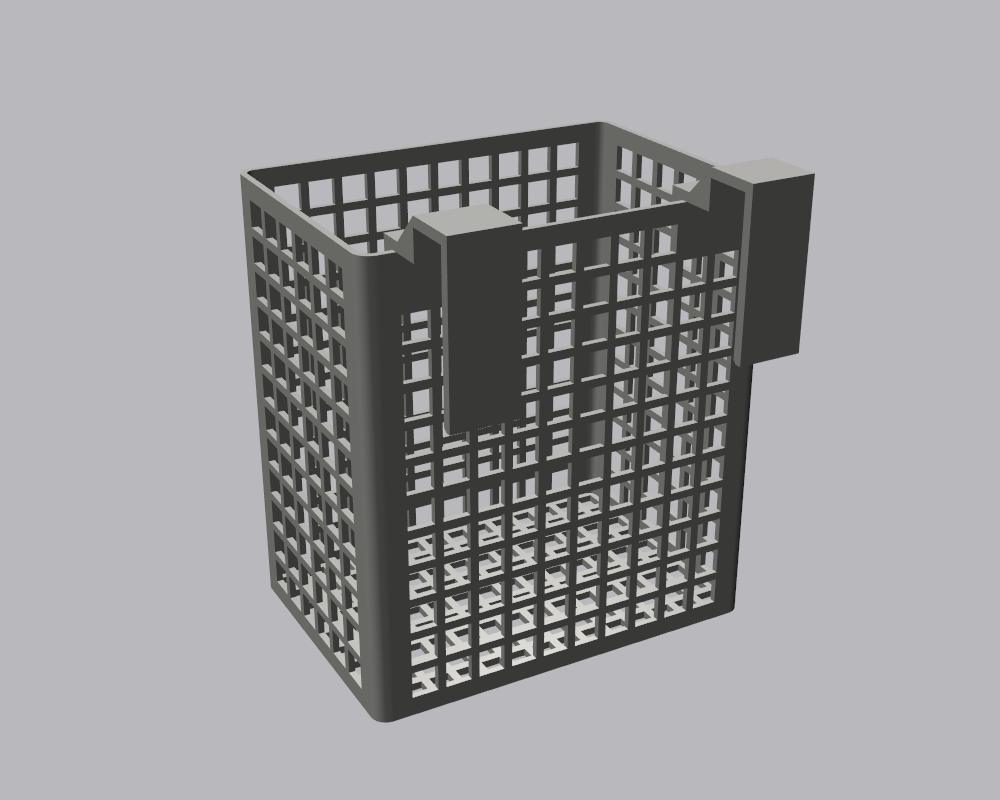
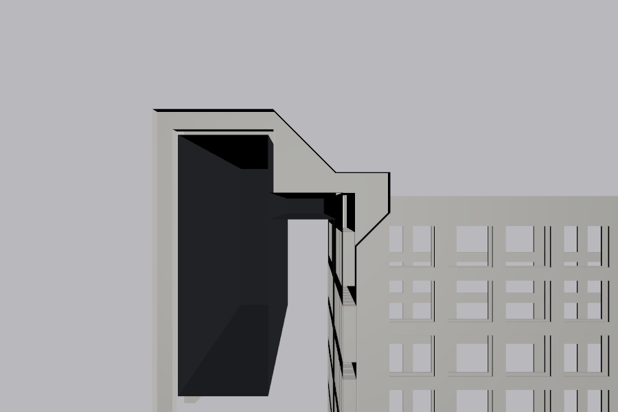

# Aquarium Basket

A grid-walled plant basket, like a dishwasher's cutlery basket, that hangs inside the tank against
its end wall. It's 5.5 in (140 mm) tall and 3.5 in (89 mm) out from the wall. Its length is worked
out so two of them fill the end wall side by side, with room to spare at the corners.

Two hooks are built into the top of each basket's back wall, so there's nothing to come loose.
Each sits on the frame's inner lip and wraps over the top of the frame, and the basket's rim ends up
level with the lip.

| Basket | Two on the end wall | Back, with the hooks |
|---|---|---|
|  |  |  |



## Printing

Designed for a Prusa MK4 printing PETG (not yet test-printed). PETG is fine in fresh water. Skip
any additives or colourants you wouldn't put in a tank.

| File | Print | Notes |
|---|---|---|
| [out/basket.stl](out/basket.stl) | 2 | 127.5 × 118 mm footprint with the hooks, 152 mm tall. Prints open top up. |

The hooks reach out over the frame, so they need supports. In PrusaSlicer, set **Supports** to
**For build plate only** and the **Style** to **Organic**. Keep **Don't support bridges** on (it
is by default). The only supports are then a small tree under each hook, standing on the bed
behind the basket. Snap them off after printing.

Everything else prints without supports:
- The wall openings are about 8 mm square, and their tops are short flat bridges.
- The floor has 6 mm openings, small enough to hold gravel or clay pebbles.
- Inside the back wall, a gusset under each hook stiffens the joint. Its underside slopes at 45°.
- Solid bands run around the rim, the bottom and either side of each corner for stiffness.

A STEP file for other CAD tools is in [out/aquarium_basket.step](out/aquarium_basket.step).

## Fit

The tank's end wall is 287 mm between the front and back lip edges. Two baskets of 127.5 mm leave
12 mm at each end and 8 mm between them, so they still fit if that measurement is a little long.
They have to stay inside the lip edges, because the rim is level with the lips and would hit the
front and back lips at the corners.

The hooks are sized for this tank's frame. The lip is 8.5 mm below the top edge and 10 mm wide,
and the frame top is 9/16 in (14.3 mm) across. A test print gripped better 1 mm narrower, so the
hooks are made for 13.3 mm. Each hook's leg down the outside of the tank is 2 in (50.8 mm) long
overall. The hooks are the same shape as the [planter's](../aquarium-planter/) clip-on hook, so
printing that hook first is a quick way to check the fit before printing the baskets.

About 115 mm of each basket sits under water when the water is 25 mm below the lip.

## Customising

Every dimension is a parameter at the top of [aquarium_basket.py](aquarium_basket.py). The ones
you're most likely to change:

| Parameter | Default | What it does |
|---|---|---|
| `HEIGHT`, `DEPTH` | 139.7, 88.9 | Basket height and how far it reaches out from the wall. |
| `COUNT` | 2 | How many baskets share the wall. The length adjusts to fit. |
| `END_CLEAR`, `BETWEEN` | 12, 8 | Room at the corners and between baskets. |
| `GRID_OPENING`, `FLOOR_OPENING` | 8, 6 | Size of the square openings in the walls and floor. |
| `OPENING` | 287 | The end wall's length between the lip edges. |
| `FRAME_TOP_W`, `FRAME_CLEAR` | 13.3, 0.8 | Raise them if the hooks won't go over the frame. Lower them if the basket leans into the tank. |
| `LEG_L` | 50.8 | Overall length of each hook's leg down the outside of the tank (2 in). |

Rebuild and re-render from the repo root:

```bash
.venv/Scripts/python aquarium-basket/aquarium_basket.py
```

```bash
.venv/Scripts/python aquarium-basket/render.py
```
