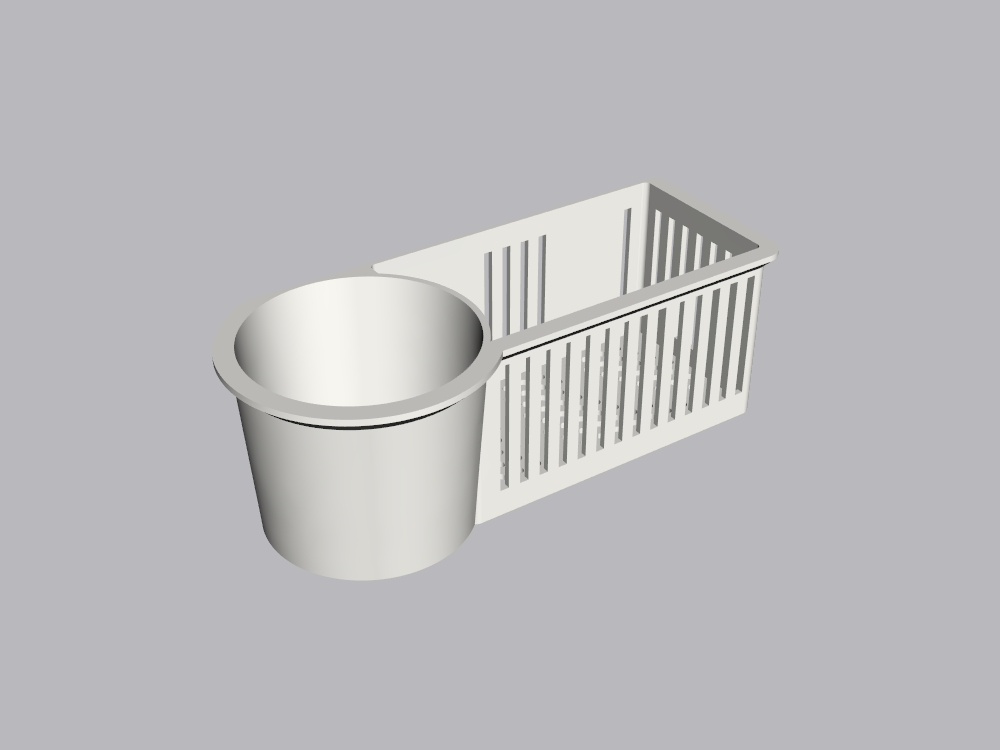
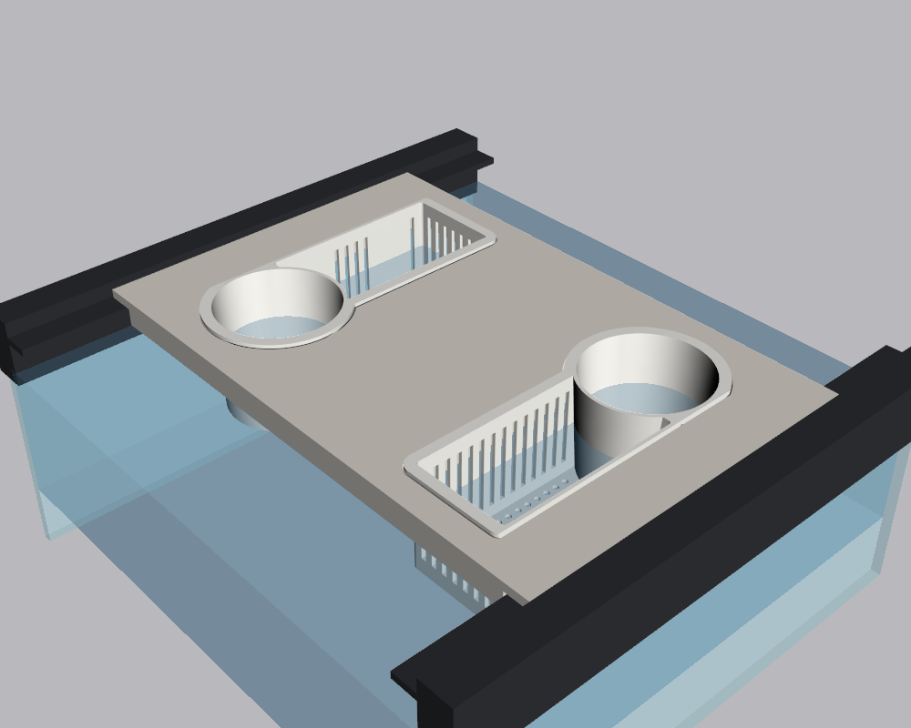
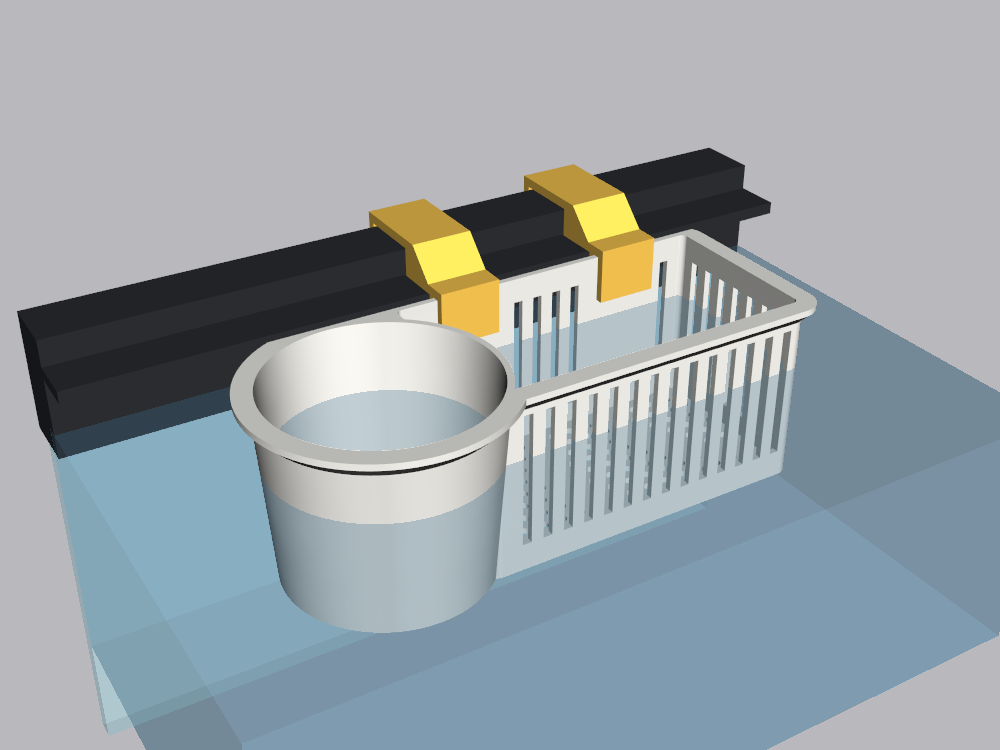
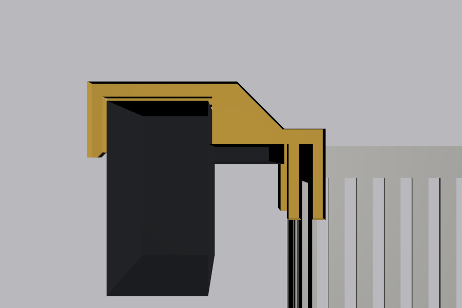
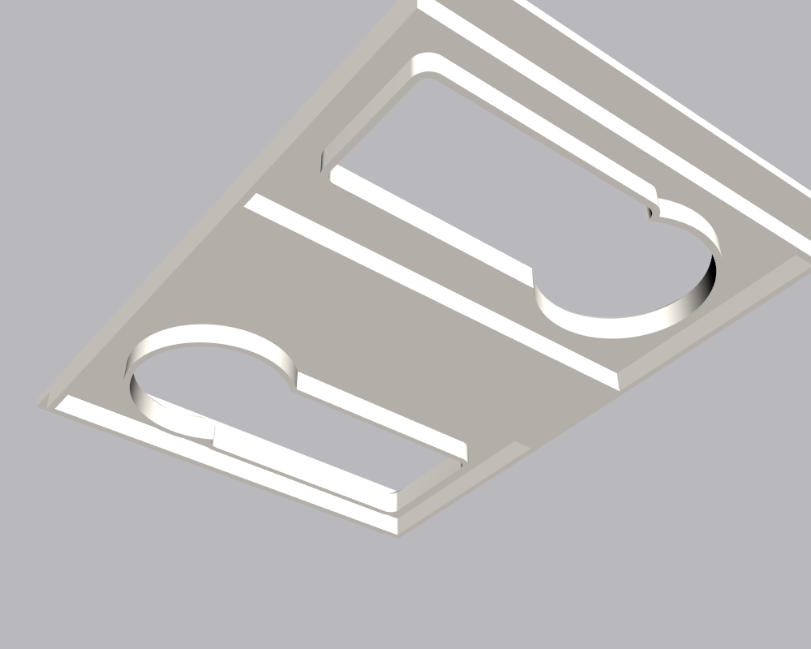

# Aquarium Planter

A planter for a framed aquarium: a round cup with a perforated floor, for feeding or holding fry,
joined to a slotted basket for a houseplant's roots (pothos, peace lily and the like). Water flows
through the basket's slots and floor holes, and through the cup's floor.

It's sized for a tank whose plastic frame has a lip inside, 8.5 mm below the top edge, where a
glass lid would sit. There are two ways to hang it:

- **In the tray.** A plate that rests on the front and back lips and holds two planters. The
  planters drop into it and hang by their rim flange. The tray's top sits 3.5 mm below the frame's
  top edge, like a glass lid.
- **On hooks.** Two clip-on hooks drop over the basket's back wall, sit on the lip and wrap over
  the top of the frame.

| Planter | In the tray | On hooks |
|---|---|---|
|  |  |  |

| Hook, cut through | Tray underside |
|---|---|
|  |  |

## Files to print

Designed for a Prusa MK4 printing PETG (not yet test-printed). PETG is fine in fresh water. Skip
any additives or colourants you wouldn't put in a tank. Every file is already laid out the way it
prints, and none needs slicer supports.

| File | Print | Notes |
|---|---|---|
| [out/hook.stl](out/hook.stl) | 2 | Print one first and try it on the frame. It's small and quick, and it checks the lip and frame sizes. |
| [out/planter.stl](out/planter.stl) | 1 per spot | 174 × 76 mm, 60 mm tall. Prints rim up. |
| [out/tray_half.stl](out/tray_half.stl) | 2 | 205 × 157 mm, 15 mm thick. Both halves are the same part. Prints top face down. |
| [out/tray_key.stl](out/tray_key.stl) | 3 | 14 × 50 × 7.5 mm keys that join the halves. |

Printing notes:
- Planter: the flange around its rim has a 45° chamfer underneath, and the wall slots have 3 mm
  flat tops, so both print without supports.
- Hook: it prints lying on its side, so its profile is flat on the bed and its layers run the
  full length of the hook.
- Tray halves: they print top face down, so the ribs build upward. The key pockets have 15 mm
  bridged roofs.

STEP files for other CAD tools are in [out/aquarium_planter.step](out/aquarium_planter.step) and
[out/tray_half.step](out/tray_half.step).

## The tray

The tank is 287 mm front to back between the lip edges, so the tray is 314 mm long. That's too
long for the MK4 bed, so it's two halves that meet in the middle. Three keys slide into pockets
in both halves. They stop the joint folding under the planters' weight. Push the keys into one
half, then push the other half on.

Lay the tray across the tank with its ends on the front and back lips. It stays put by its own
weight and can sit anywhere along the tank, as long as it's clear of the filter and the centre
brace. Ribs underneath stiffen it and stop 2 mm short of each lip. Each half has a hole for a
planter, with a countersink for the flange's chamfer so the flange sits flat. Each planter's flat
back faces the nearest tank wall.

## The hooks

Each hook drops onto the basket's back wall, where the slots stop to make room for it. Its pad
sits on the lip, and its arm goes over the top of the frame to a leg down the outside. The leg is
what keeps the planter from tipping into the tank. The planter's rim ends up level with the lip.
Water usually sits a little below the lip, so about 35 mm of the cup and basket is under water.

## Measuring your tank

The defaults fit the tank this was designed for. Check these on yours before printing the big
parts:

| Parameter | Value | What to measure |
|---|---|---|
| `OPENING` | 287 | Front to back between the lip edges. The tray is this plus 13.5 mm on each end. |
| `LIP_DROP` | 8.5 | Top edge of the frame down to the lip. |
| `LIP_W` | 15 | How far the lip sticks out from the frame's inner wall. |
| `FRAME_TOP_W` | 20 | **Estimated, please measure.** Across the top of the frame, from its inner wall (above the lip) to its outside face. Only the hooks use it. |

If the hook won't go over the frame, raise `FRAME_TOP_W`. If the planter leans into the tank,
the hook is too loose: lower `FRAME_TOP_W` or `FRAME_CLEAR`.

## Customising

Every dimension is a parameter at the top of [aquarium_planter.py](aquarium_planter.py). Others
you might change:

- `HEIGHT`: depth of the cup and basket.
- `CUP_D`, `CUP_BOTTOM_D`: the cup's diameter at the rim and at the bottom.
- `CUP_HOLE_D`: the cup's floor holes. Keep them smaller than your fry and food.
- `BASKET_L`, `BASKET_W`: basket size. The planter has to fit between the tray's ribs; the
  script stops with a message if it doesn't.
- `RIM_ABOVE_LIP`: raise the planter on its hooks.
- `TRAY_W`: tray width along the tank, up to 210 mm for the MK4 bed.
- `KEY_CLEAR`: looser or tighter keys.

Rebuild and re-render from the repo root:

```bash
.venv/Scripts/python aquarium-planter/aquarium_planter.py
```

```bash
.venv/Scripts/python aquarium-planter/render.py
```
