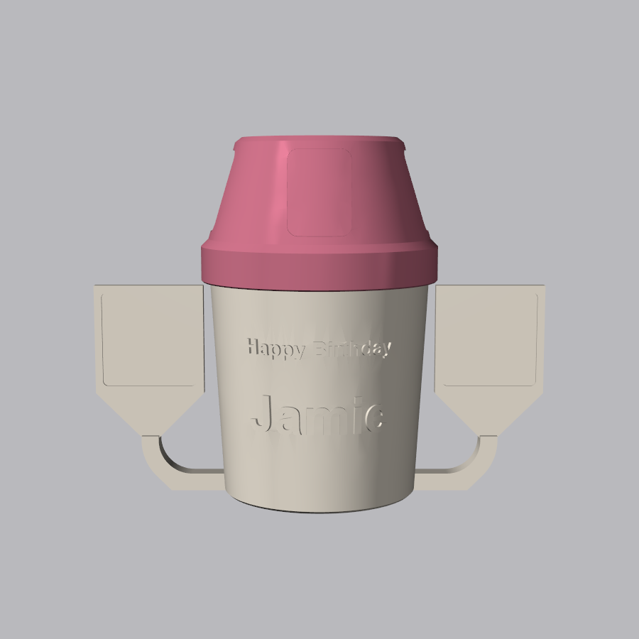
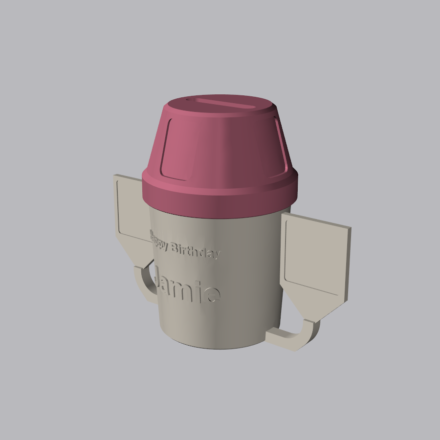
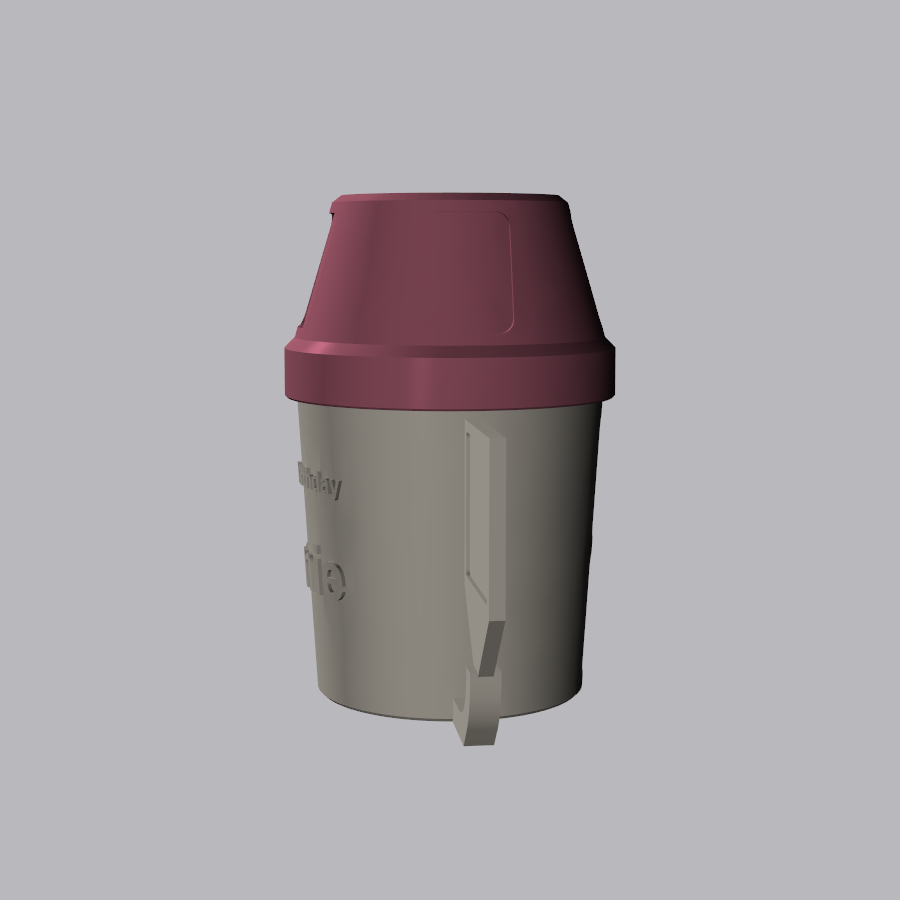
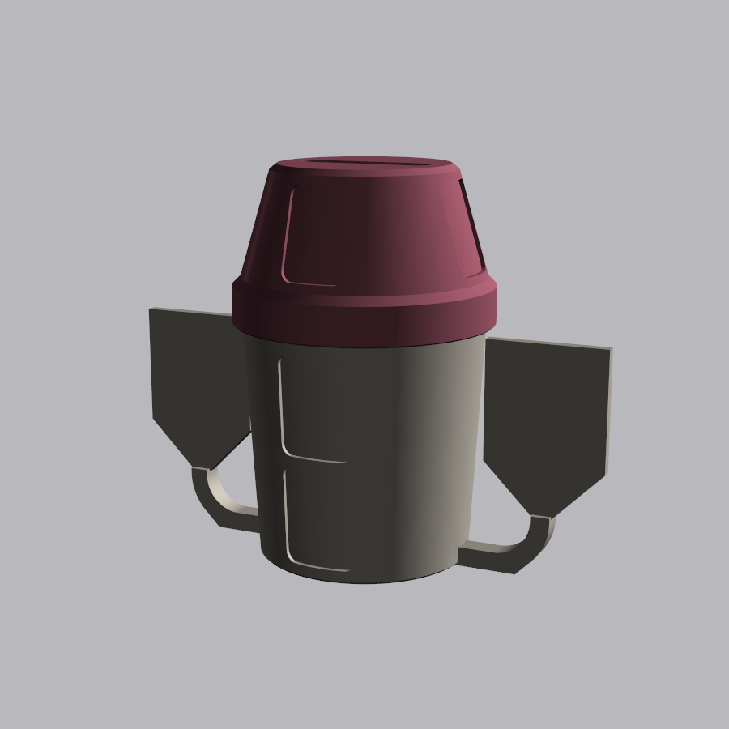

# Barista Birthday Tip Cup

A birthday present for a barista: the [tip cup jar](../tip-cup-jar/) with the barista's name
and "Happy Birthday" in raised letters on the front, and two front-facing billboards for QR
code stickers (Cash App, Venmo and so on). Each billboard sits on a post that comes out of the
base of the cup and curves up like a mug handle. The lid unscrews to empty the tips.

| Front | Angle |
|---|---|
|  |  |

| Side | Back (photo spots) |
|---|---|
|  |  |

## Make one with their name

From the repo root:

```bash
.venv/Scripts/python barista-gift/barista_gift.py --name "Jamie"
.venv/Scripts/python barista-gift/render.py
```

| Option | Default | What it does |
|---|---|---|
| `--name` | Jamie | Name on the front |
| `--name-size` | 20 | Name font size in mm |
| `--greeting` | Happy Birthday | Line above the name |
| `--greeting-size` | 8 | Greeting font size in mm |
| `--font` | Arial | Any installed font, drawn bold |

For example:

```bash
.venv/Scripts/python barista-gift/barista_gift.py --name "Sam" --name-size 24 --font "Georgia"
```

Text wider than the front of the cup (64 mm for the name, 70 mm for the greeting) shrinks to
fit, and the script says when it does. Thin script fonts such as Segoe Script work, but their
fine strokes are delicate when printed. Chunkier fonts print more cleanly.

## Files to print

Both parts print without supports. Designed for a Prusa MK4 printing PETG (not yet test-printed).

| File | Notes |
|---|---|
| [out/cup.stl](out/cup.stl) | 182 mm wide across the billboards, 102 mm tall. Print upright. |
| [out/lid.stl](out/lid.stl) | The tip cup jar's lid with a 50 × 10 mm slot for folded bills and coins. Already flipped top-down for printing. |

The posts start flat on the bed and have a 45° chamfer under the curve. Each billboard has a
V-shaped bottom that meets the post at 45°, so nothing overhangs too far to print. A STEP
assembly is in [out/barista_gift_assembly.step](out/barista_gift_assembly.step).

The letters stand 1.2 mm proud of a vertical wall, so a filament colour change won't pick them
out. For contrasting letters, go over them with a paint pen after printing.

## Stickers

| Where | Recess | Sticker |
|---|---|---|
| QR billboards (2) | 38 × 38 mm, 1 mm deep | **36 × 36 mm** square |
| Cup back (2 photo spots) | 27 × 36 mm | 25 × 34 mm |
| Lid (4 photo spots) | 24 × 32 mm | 22 × 30 mm |

For the QR codes, save each payment app's QR code from its profile screen, print it at 36 mm on
sticker paper and cut it out. Leave a white border around the code so phones can read it.

The photo spots work the same as on the tip cup jar. Its
[sticker templates](../tip-cup-jar/README.md#photoshop-templates-cricut-print-then-cut) are
already the right sizes.

## Customising

The front text, billboard size and position, QR recess size and slot width are parameters at
the top of [barista_gift.py](barista_gift.py). The cup body, thread, lid and coin slot come from
[tip_cup.py](../tip-cup-jar/tip_cup.py), so thread fit changes made there carry over.
