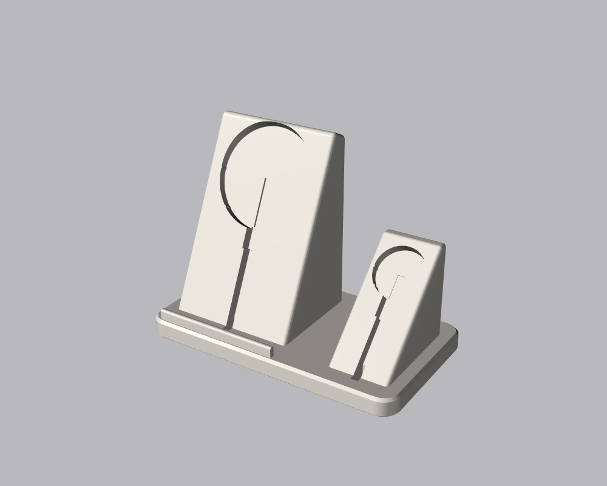
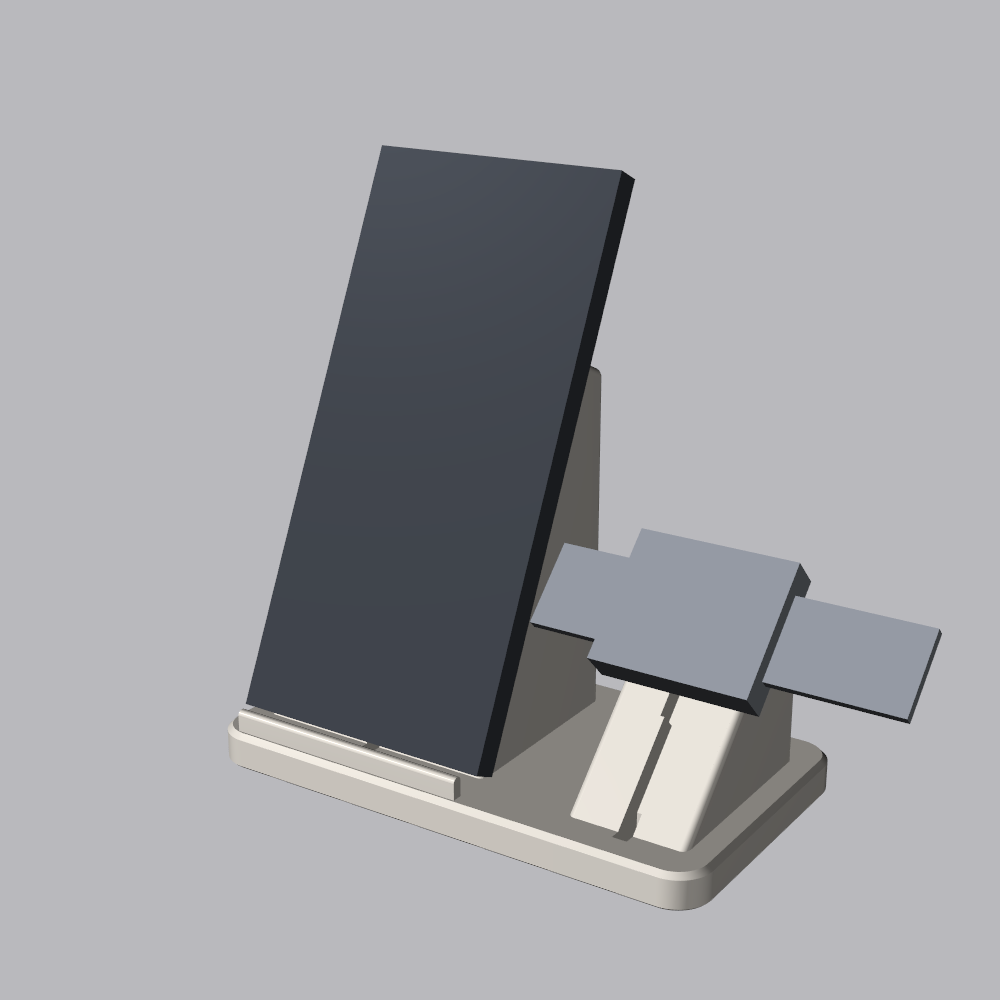

# Phone and Watch Charging Stand

A desk stand that holds an Apple MagSafe charger for an iPhone 14 Pro Max (portrait, no case,
leaning back 25°) and an Apple Watch charger on a 45° pad beside it. The cables press into
slots and run under the base to the back.

| Stand | In use (phone and watch are stand-ins) |
|---|---|
|  |  |

## Files to print

Designed for a Prusa MK4 printing PETG (not yet test-printed).

| File | Notes |
|---|---|
| [out/fit_test.stl](out/fit_test.stl) | Both charger pockets in thin plates. Print this first to check the fit. |
| [out/stand.stl](out/stand.stl) | 150 × 84 mm footprint, 111 mm tall. Print flat on its base, no supports. |

Nothing overhangs more than 40° from vertical. The top of each charger pocket is angled back
into the stand for this, so there's a small crescent-shaped gap above each puck. The phone and
watch hide it. The only flat spans are short bridges: the cable grooves (4.2 mm) and the
rubber-foot recesses (13 mm) underneath.

A STEP file for other CAD tools is in [out/phone_stand.step](out/phone_stand.step).

The stand is light for its size, so pulling the phone straight off can lift it. Use 4 or more
perimeters and 25% or more infill for weight, stick 12.7 mm (½ in) rubber bumpers in the four
recesses underneath, and slide the phone up off the magnet rather than pulling it straight out.

## Fitting the chargers

1. Press each puck into its pocket with the cable pointing down the slot. Four small crush ribs
   on the sides and lower edge grip the puck.
2. Press the cable into the slot down the face, then down through the slot in the base and back
   along the groove underneath. It leaves from the back edge.

Each puck sits slightly proud of the face so it touches the phone or watch. The MagSafe pocket
is sized for the original (2020) charger:

| Charger | Diameter | Thickness | Stands proud by |
|---|---|---|---|
| MagSafe Charger, original (2020) | 55.9 mm | 5.3 mm | 0.7 mm |
| Apple Watch charger | about 27.5–28 mm | 6.5–8.2 mm by model | 1–2.7 mm |

For the thinner 2024 25 W MagSafe Charger (55.5 × 4.45 mm), set `MAGSAFE_POCKET` to 3.9 and
rebuild, or it will sit below the surface.

Apple doesn't publish puck dimensions and they change between models, so these come from
teardowns and other makers' measurements. Measure yours with calipers if the fit test is off.

## Customising

Every dimension is a parameter at the top of [phone_stand.py](phone_stand.py). The ones you're
most likely to change:

- `MAGSAFE_D`, `WATCH_D`, `MAGSAFE_POCKET`, `WATCH_POCKET`: puck size and pocket depth.
- `RIB_PROTRUDE`: tighter or looser grip on the pucks.
- `MAGSAFE_FROM_BOTTOM`: where the phone's MagSafe ring sits above its bottom edge (about
  half the phone's height). It sets the puck height above the ledge.
- `CAMERA_FROM_BOTTOM`: the tower stops below the camera bump. The script refuses to build if
  they would collide.
- `TILT`, `PAD_TILT`: how far the phone and watch lean back. The pocket tops adjust
  automatically to stay within `MAX_OVERHANG`.
- `PAD_GAP`: room between the phone and the watch for the band to hang.

To use a case, add its thickness to `PHONE_T`. The phone is held by the magnet only in portrait.
Landscape would hit the watch pad.

Rebuild and re-render from the repo root:

```bash
.venv/Scripts/python phone-stand/phone_stand.py
.venv/Scripts/python phone-stand/render.py
```
