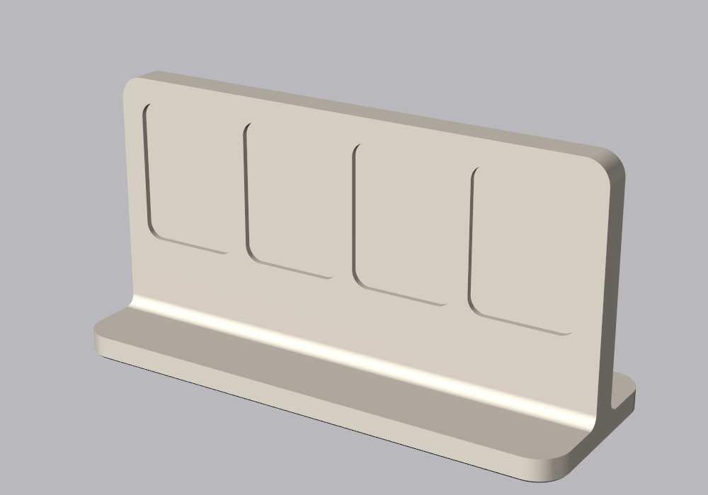
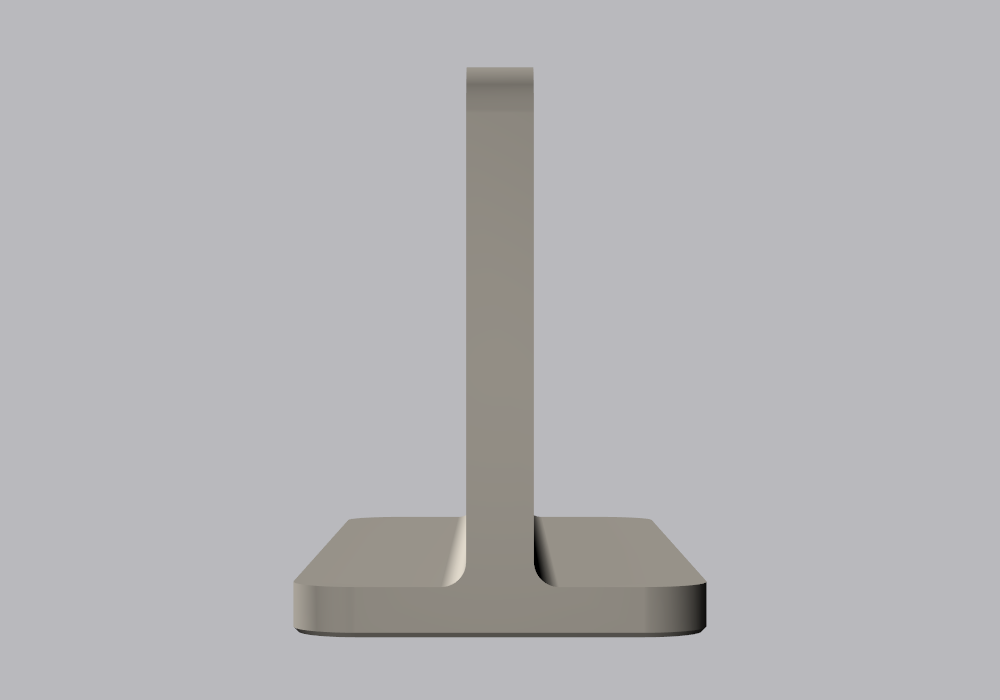

# Sticker Stand

A simple double-sided desktop stand shaped like an upside-down T: a flat base with a vertical
wall standing in the middle of it, and four recessed sticker spots on each side of the wall.
A plain band of wall sits between the base and the bottom of the stickers.

| Front | Back | Side |
|---|---|---|
|  |  |  |

## Files to print

Designed for a Prusa MK4 printing PETG (not yet test-printed).

| File | Notes |
|---|---|
| [out/stand.stl](out/stand.stl) | 132 × 50 mm footprint, 68 mm tall. Print flat on its base, no supports. |

Printed this way, the top edge of each recess is a 1.5 mm deep flat ceiling, which bridges
across the 27 mm spot. If it sags a little, the sticker still sits below it.

A STEP file for other CAD tools is in [out/sticker_stand.step](out/sticker_stand.step).

## Stickers

The eight spots are the same as the tip cup's, so the same stickers fit both.

| Spots | Recess | Sticker |
|---|---|---|
| 4 in a row on each side | 27 × 36 mm, 1.5 mm deep, 4 mm corners | **25 × 34 mm**, 3 mm corners |

Use `sticker_cup.psd` from the [tip cup's Photoshop template](../tip-cup-jar/stickers/sticker_template.jsx)
and follow the [Cricut steps](../tip-cup-jar/README.md#photoshop-templates-cricut-print-then-cut).

## Customising

Every dimension is a parameter at the top of [sticker_stand.py](sticker_stand.py). Set the size
of the stand and how many spots you want, and the spots are sized to fill the wall:

| Parameter | Default | What it does |
|---|---|---|
| `STAND_W` | 132 | Overall width |
| `STAND_H` | 68 | Overall height, base included |
| `SPOT_COLUMNS` | 4 | Spots across the wall, per side |
| `SPOT_ROWS` | 1 | Rows of spots, per side. Use 2 columns and 2 rows with a 70 × 108 mm stand for a narrower, taller one. |
| `SPOT_ASPECT` | 4/3 | Height of a spot divided by its width |
| `SPOT_GAP` | 4 | Minimum space between neighbouring spots |
| `SPOT_MARGIN` | 6 | Space kept clear at the sides and top of the block of spots |
| `SPOT_BOTTOM_MARGIN` | 20 | Minimum plain wall between the base and the bottom of the spots |
| `BASE_D` | 50 | Depth of the base, front to back. Widen it if you make the stand much taller. |
| `WALL_T` | 8 | Wall thickness. 5 mm remains between the front and back recesses. |

Each spot is the largest that fits at `SPOT_ASPECT`, and the build prints its size. Stickers are
1 mm smaller than the recess all round, so only the default size fits the tip cup's stickers. If
the wall is wider or taller than the spots need, they spread out evenly to fill it. If it is too
small for the count you asked for, the build stops with an error.

Rebuild and re-render from the repo root:

```bash
.venv/Scripts/python sticker-stand/sticker_stand.py
```

```bash
.venv/Scripts/python sticker-stand/render.py
```
