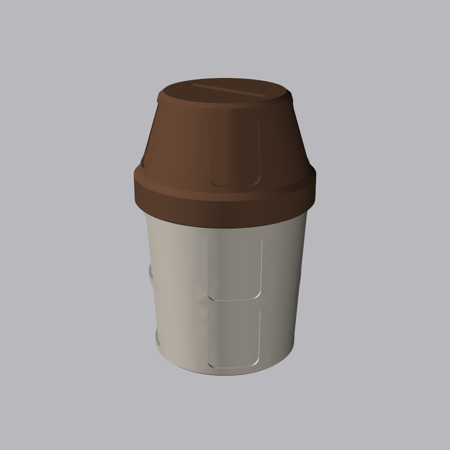
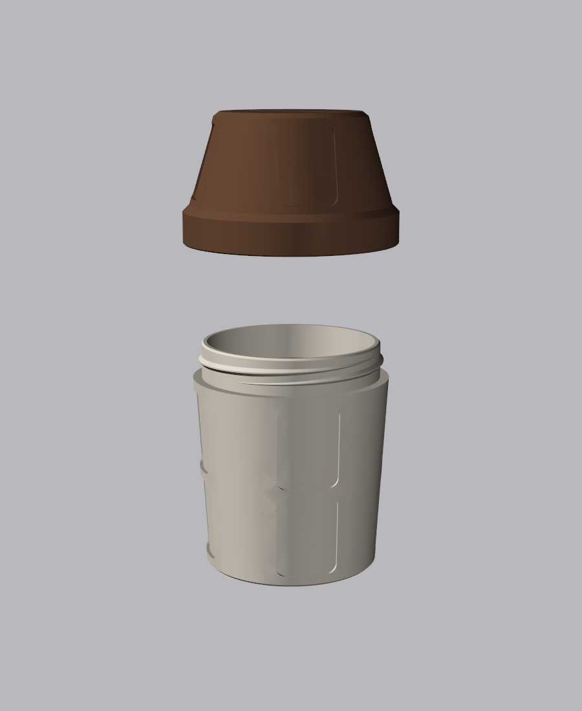

# Tip Cup Jar

A coffee-cup tip jar with a screw-on lid, a money slot for coins and folded bills, and
recessed spots for stickers.

| Assembled | Exploded |
|---|---|
|  |  |

## Files to print

Both parts print without supports. Designed for a Prusa MK4 printing PETG (not yet test-printed).

| File | Notes |
|---|---|
| [out/cup.stl](out/cup.stl) | 88 mm wide, 102 mm tall. Print upright. |
| [out/lid.stl](out/lid.stl) | Already flipped top-down for printing. |

The assembled jar is about 143 mm tall. A STEP assembly for other CAD tools is in
[out/tip_cup_assembly.step](out/tip_cup_assembly.step).

Print tips: set the seam to *Rear* or *Aligned* so the threads turn smoothly.

## Stickers

Every recess is 40 × 30 mm and 1.5 mm deep with 4 mm corner radii. Use **38 × 28 mm** stickers
with 3 mm rounded corners. The cup has 8 spots and the lid has 4, for 12 in total.

### Photoshop template (Cricut Print Then Cut)

[stickers/sticker_template.psd](stickers/sticker_template.psd) is one sticker at exactly
38 × 28 mm, 300 DPI, with no bleed or margins. The **Sticker** group is masked to the rounded
corners, so anything you put in it is trimmed to the sticker shape.

1. Open the PSD. With the *Your design* layer selected, use **File > Place Embedded** so the
   artwork lands inside the group.
2. **File > Export > Export As**, PNG with transparency on. Save one PNG per sticker.
3. In Cricut Design Space, upload the PNG as a **Print Then Cut** image. The transparent
   corners become the cut line.
4. On the canvas, lock the proportions and set the width to **38 mm (1.5 in)**, then print
   and cut on sticker paper.

To change the sticker size, edit the numbers at the top of
[stickers/sticker_template.jsx](stickers/sticker_template.jsx) and run it in Photoshop with
**File > Scripts > Browse**. It rebuilds the PSD next to itself.

## Threads

2-start thread, so the lid goes on or off in about one turn. 45° flanks print cleanly in any
orientation. Clearance is 0.4 mm radial and 0.35 mm axial per flank (about 0.25 mm normal
to the flank), which is a slightly loose fit suited to PETG.

If the lid is too tight or loose on your printer, change `THREAD_AXIAL_GAP` (and if needed
`THREAD_CLEARANCE`) in [tip_cup.py](tip_cup.py) and reprint the lid.

## Customising

Every dimension is a parameter at the top of [tip_cup.py](tip_cup.py): cup height and taper,
sticker spot size and positions, slot size and thread fit. Rebuild and re-render from the
repo root:

```bash
.venv/Scripts/python tip-cup-jar/tip_cup.py
.venv/Scripts/python tip-cup-jar/render.py
```
