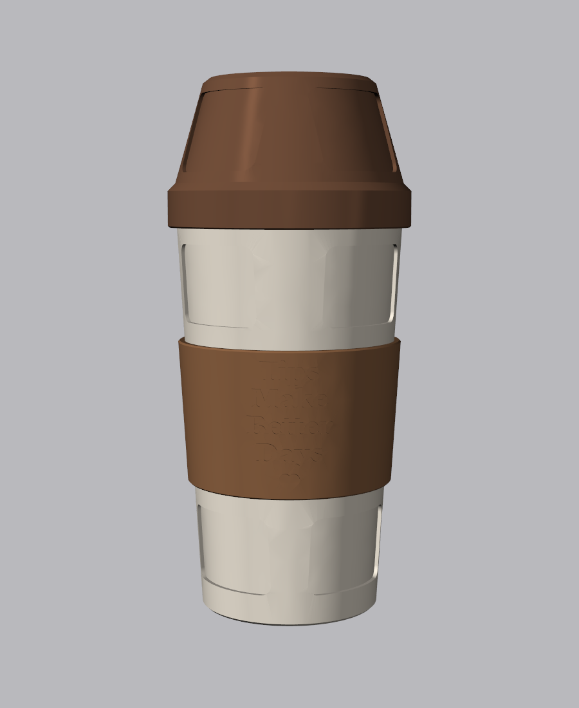
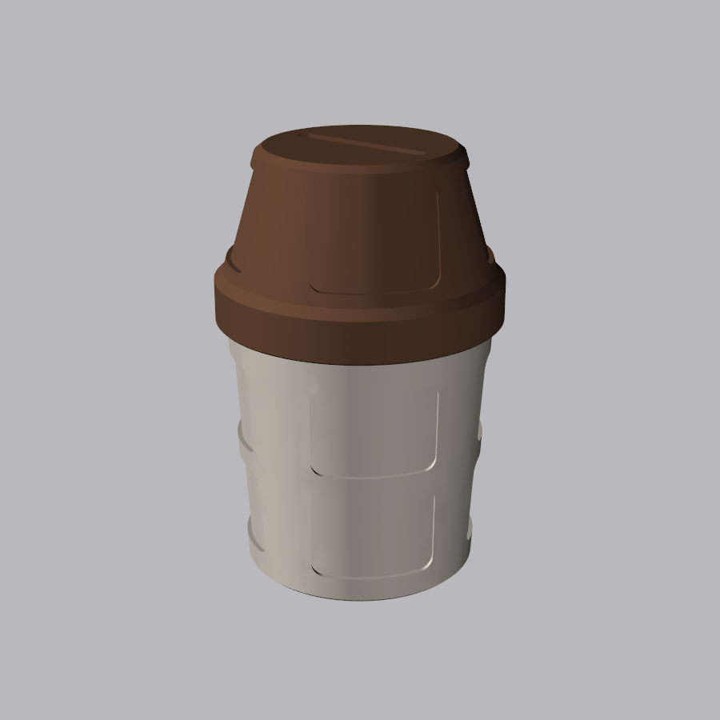

# Tip Cup Jar

A coffee-cup tip jar with a screw-on lid, a money slot for coins and folded bills, and
recessed spots for stickers. It comes in two versions that share the same lid:

| Tall cup with sleeve | Short cup, no sleeve |
|---|---|
|  |  |

## Files to print

All parts print without supports. Designed for a Prusa MK4 printing PETG (not yet test-printed).

| File | Notes |
|---|---|
| [out/lid.stl](out/lid.stl) | Already flipped top-down for printing. Fits both cups. |
| [out/cup.stl](out/cup.stl) | Tall cup, 166 mm. Print upright. |
| [out/sleeve.stl](out/sleeve.stl) | For the tall cup. Print in a second colour; slides on from the bottom and wedges on the taper. |
| [out/cup_short.stl](out/cup_short.stl) | Short cup, 102 mm, no sleeve. Print upright. |

STEP assemblies for other CAD tools: [tall](out/tip_cup_assembly.step), [short](out/tip_cup_short_assembly.step).

Print tips: set the seam to *Rear* or *Aligned* so the threads turn smoothly.

## Stickers

Every recess is 40 × 30 mm and 1.5 mm deep with 4 mm corner radii. Use **38 × 28 mm** stickers
with rounded corners. Each cup has 8 spots and the lid has 4, for 12 per assembled jar.

## Threads

2-start thread, so the lid goes on or off in about one turn. 45° flanks print cleanly in any
orientation. Clearance is 0.4 mm radial and 0.35 mm axial per flank (about 0.25 mm normal
to the flank), which is a slightly loose fit suited to PETG.

If the lid is too tight or loose on your printer, change `THREAD_AXIAL_GAP` (and if needed
`THREAD_CLEARANCE`) in [tip_cup.py](tip_cup.py) and reprint the lid.

## Customising

Every dimension is a parameter at the top of [tip_cup.py](tip_cup.py): cup height and taper,
sticker spot size and positions, sleeve text, slot size and thread fit. Rebuild and re-render
from the repo root:

```bash
.venv/Scripts/python tip-cup-jar/tip_cup.py
.venv/Scripts/python tip-cup-jar/render.py
```
